# Полный mind map проекта ProxyDroid

Source version: **3.8.1** в рабочей ветке. Карта описывает модули/связи/границы реализации, а не подтверждает merge или успешный OEM device QA. [Интерактивная карта](MINDMAP.html) · [Архитектура](ARCHITECTURE.md) · [Roadmap](../ROADMAP.md).

```mermaid
mindmap
  root((ProxyDroid 3.8.1))
    UX · TV  ·  Phone
      Вход
        ProxyDroid activity · VPN consent/result · foreground start · MainScreen
      Подключение
        ConnectionCard · DPAD initial focus · TCP/internet statuses · YouTube offer
      Настройки
        AutoGatewayCard to Host/Port to ProfileCard to ProxyForm to Startup to Advanced
      Редактирование
        EditableSettingField · click/DPAD OK · dialog focus · draft/validation/Cancel
      Приложения
        AppManager · allow-list / bypass-list · BypassListActivity
      Оформление
        Compose Theme · DrawablePainter · TV banner · leanback / phone launchers
      Widget
        ProxyDroidWidgetProvider · on/off with existing consent path
    Состояние и профили
      View model
        MainViewModel · StateFlow MainUiState · lifecycle jobs/cancellation
      Профиль
        Profile · defaults 10808 · host/type/auth/app lists · boot/gateway flags
      Хранилище
        SharedPreferences current flat settings + JSON by profile ID · apply
      Операции
        select/new/rename/delete · writes on Main · reload/generation guards
      Runtime
        Utils working/connecting/errors · immutable activeUpstream snapshot
      Диагностика
        BootStatus · latest boot outcome/time · no credentials in endpoint toString
      Legacy helpers
        Constraints · ListPreferenceMultiSelect · Base64 · ProxyInputValidation
      Оставшийся долг
        profile bookkeeping, NTLM/PAC/SSID semantics, Keystore-backed credentials
    Сеть и gateway
      Обнаружение
        ConnectivityManager · LinkProperties · physical INTERNET + NOT_VPN · IPv4 default route
      События
        startup/resume · physical network callbacks · auto toggle · selected auto profile
      Применение
        gatewayIp display always · Host/JSON write only auto mode · manual Host preserved
      Гонки
        request generation + profile ID · callbacks/job cleanup in onCleared
      Service gate
        fresh gateway again · no stale-host fallback in auto · wait during boot
      TCP liveness
        NetworkUtils probeProxy/isProxyAlive · timed socket · polling ~15 sec
      Ограничения
        gateway need not run a proxy · mobile/no IPv4 route · multi-network fallback
    VPN  ·  JNI  ·  Rust
      Контроль
        ProxyController to foreground ProxyDroidVpnService to Builder / TUN
      TUN
        10.0.0.1/24 · MTU 1500 · IPv4 0.0.0.0/0 · DNS 10.0.0.2
      App routing
        allowed OR disallowed apps · own UID bypass · protected upstream sockets
      Native entry
        Tun2SocksHelper to lib.rs JNI to tun2socks.rs Tokio / netstack-smoltcp
      Прокси
        SOCKS5 user/password · SOCKS4a · HTTP Basic CONNECT · HTTPS CONNECT
      DNS
        UDP/53 to dns_table.rs mapping to doh_client.rs to Cloudflare/Google DoH via proxy
      Lifecycle · security
        start/stop FD/runtime · error.rs · logging.rs · protect.rs · per-session DoH refresh · WebPKI TLS
      Сборка native
        Cargo.toml/lock · CMake · cargo Android targets arm/arm64/x86/x86_64
      Не реализовано
        generic UDP/QUIC · complete IPv6 · full NTLM/PAC
    Загрузка и жизненный цикл
      Пользователь
        Start on boot opt-in · selected stored profile · VPN consent granted once
      События
        ProxyDroidReceiver · BootPolicy · BOOT_COMPLETED / MY_PACKAGE_REPLACED / OEM quickboot
      Безопасность
        UserManager unlock · no background Activity/consent dialog · no Direct Boot credential copy
      Запуск
        ContextCompat.startForegroundService to immediate foreground · type specialUse API34+
      Ожидание
        physical network + optional gateway + TCP proxy ready · max 120 sec · cancellation / idempotency
      Восстановление
        null service restart uses stored profile · explicit Stop closes native/TUN
      Legacy network
        ConnectivityBroadcastReceiver · SSID matching · platform broadcast restrictions
      Риски
        Force stop · first open · revoked consent · another VPN · OEM power/autostart restrictions
    Интернет to YouTube
      Условие
        VPN working to actual activeUpstream snapshot to distinct internet check
      Транспорт
        ProxyTransport handshake · remote DNS · credentials only to configured proxy
      TLS · HTTP
        InternetProbe · trusted TLS + hostname · GET /generate_204 · status 204 only
      Endpoints
        www.google.com · connectivitycheck.gstatic.com fallback · no analytics SDK
      Budget
        connect/read timeouts · header/line caps · read deadline · bounded retry
      UI gate
        checking / failed+Retry / success+Open YouTube · stale/disconnect guard
      Открытие
        explicit click · YouTube TV to phone to HTTPS handler · package visibility queries
      Граница доказательства
        upstream probe ≠ full TUN path/YouTube playback · Google block false negative · allow-list matters
    Обновления и release
      Updater UI
        AppUpdateDialog / UpdateViewModel / full clickable APK path · Stable vs Test · progress/cancel
      Каталог
        ReleaseCatalog · no drafts/debug · channel consistency · trusted asset URLs · compatible ABI
      Download
        GitHubUpdater · HTTPS allowlisted redirects · private cache/updates · bounded bytes/checksum
      APK trust
        actual package/version/minSDK/native ABI · current installed signer · downgrade refusal
      Установка
        UpdateFileProvider scoped URI · Android visible Activity + unknown sources resume + installer confirmation · no silent install
      Версия · имя
        version.properties to 3.8.1 / 30800 · build_metadata.py to platform/ABI/channel/run/attempt/commit
      CI
        android-build.yml build/unit/lint/blocking emulator · fixtures · exact-SHA publication gate
      Публикация
        release-apk.yml · pinned keystore · signature/zipalign/nondebug/ABI · draft then publish both APKs
      Автоматизация
        auto-tag-release.yml explicit dispatch · prerelease-from-pr label to artifacts, no rolling overwrite
      Секреты
        permanent signing key only private env/secrets · backup/export separate owner authorization
    QA · docs · развитие
      JVM tests
        ProfileDefaults/ProxyInputValidation/NetworkUtils · ReleaseCatalog · BootPolicy · ProxyTransport
      Android tests
        EditableSettingField · MainScreenTv · InternetActions · GatewayStartup · host SOCKS/HTTP fixtures
      Скрипты
        check_tv_contract · test_build_metadata · run_emulator_tests · local/integration runners
      Device QA
        real boot/standby/consent · Wi-Fi/Ethernet · TUN/DNS · YouTube · signed installer/ABI
      Документы
        README · AUTO_GATEWAY · ARCHITECTURE · BOOT_AUTOSTART · INTERNET_YOUTUBE · TV_REVIEW · RELEASE_SIGNING
      История · privacy
        CHANGELOG · privacy_policy · archived SESSION-2026-09-30 · GPL headers
      План LAN discovery
        explicit approved LAN scan to protocol/auth/TLS checks to detailed catalog to add profile/connect
      План данных
        network identity + host/port/protocol · timestamps/latency/status · unknown fields honest · dedup/TTL
      План защиты
        no brute force/credential reuse · bounded/cancellable scan · no public subnet enumeration
      Будущее
        safe trusted-only recovery · Room/catalog migration · Keystore · custom CA · IPv6/UDP · localization
```

## Текстовая карта (полный fallback)

### UX · TV / Phone
Работает в текущих исходниках

- **Вход:** ProxyDroid activity · VPN consent/result · foreground start · MainScreen
- **Подключение:** ConnectionCard · DPAD initial focus · TCP/internet statuses · YouTube offer
- **Настройки:** AutoGatewayCard → Host/Port → ProfileCard → ProxyForm → Startup → Advanced
- **Редактирование:** EditableSettingField · click/DPAD OK · dialog focus · draft/validation/Cancel
- **Приложения:** AppManager · allow-list / bypass-list · BypassListActivity
- **Оформление:** Compose Theme · DrawablePainter · TV banner · leanback / phone launchers
- **Widget:** ProxyDroidWidgetProvider · on/off with existing consent path

### Состояние и профили
Работает; есть legacy-долг

- **View model:** MainViewModel · StateFlow MainUiState · lifecycle jobs/cancellation
- **Профиль:** Profile · defaults 10808 · host/type/auth/app lists · boot/gateway flags
- **Хранилище:** SharedPreferences current flat settings + JSON by profile ID · apply()
- **Операции:** select/new/rename/delete · writes on Main · reload/generation guards
- **Runtime:** Utils working/connecting/errors · immutable activeUpstream snapshot
- **Диагностика:** BootStatus · latest boot outcome/time · no credentials in endpoint toString
- **Legacy helpers:** Constraints · ListPreferenceMultiSelect · Base64 · ProxyInputValidation
- **Оставшийся долг:** profile bookkeeping, NTLM/PAC/SSID semantics, Keystore-backed credentials

### Сеть и gateway
Работает; multi-network QA нужен

- **Обнаружение:** ConnectivityManager · LinkProperties · physical INTERNET + NOT_VPN · IPv4 default route
- **События:** startup/resume · physical network callbacks · auto toggle · selected auto profile
- **Применение:** gatewayIp display always · Host/JSON write only auto mode · manual Host preserved
- **Гонки:** request generation + profile ID · callbacks/job cleanup in onCleared
- **Service gate:** fresh gateway again · no stale-host fallback in auto · wait during boot
- **TCP liveness:** NetworkUtils probeProxy/isProxyAlive · timed socket · polling ~15 sec
- **Ограничения:** gateway need not run a proxy · mobile/no IPv4 route · multi-network fallback

### VPN / JNI / Rust
Реализован IPv4/TCP + DNS

- **Контроль:** ProxyController → foreground ProxyDroidVpnService → Builder / TUN
- **TUN:** 10.0.0.1/24 · MTU 1500 · IPv4 0.0.0.0/0 · DNS 10.0.0.2
- **App routing:** allowed OR disallowed apps · own UID bypass · protected upstream sockets
- **Native entry:** Tun2SocksHelper → lib.rs JNI → tun2socks.rs Tokio / netstack-smoltcp
- **Прокси:** SOCKS5 user/password · SOCKS4(a) · HTTP Basic CONNECT · HTTPS CONNECT
- **DNS:** UDP/53 → dns_table.rs mapping → doh_client.rs → Cloudflare/Google DoH via proxy
- **Lifecycle/security:** start/stop FD/runtime · error.rs · logging.rs · protect.rs · per-session DoH refresh · WebPKI TLS
- **Сборка native:** Cargo.toml/lock · CMake · cargo Android targets arm/arm64/x86/x86_64
- **Не реализовано:** generic UDP/QUIC · complete IPv6 · full NTLM/PAC

### Загрузка и жизненный цикл
Software tests; real OEM reboot pending

- **Пользователь:** Start on boot opt-in · selected stored profile · VPN consent granted once
- **События:** ProxyDroidReceiver · BootPolicy · BOOT_COMPLETED / MY_PACKAGE_REPLACED / OEM quickboot
- **Безопасность:** UserManager unlock · no background Activity/consent dialog · no Direct Boot credential copy
- **Запуск:** ContextCompat.startForegroundService → immediate foreground · type specialUse API34+
- **Ожидание:** physical network + optional gateway + TCP proxy ready · max 120 sec · cancellation / idempotency
- **Восстановление:** null service restart uses stored profile · explicit Stop closes native/TUN
- **Legacy network:** ConnectivityBroadcastReceiver · SSID matching · platform broadcast restrictions
- **Риски:** Force stop · first open · revoked consent · another VPN · OEM power/autostart restrictions

### Интернет → YouTube
Новая функция 3.8.1

- **Условие:** VPN working → actual activeUpstream snapshot → distinct internet check
- **Транспорт:** ProxyTransport handshake · remote DNS · credentials only to configured proxy
- **TLS/HTTP:** InternetProbe · trusted TLS + hostname · GET /generate_204 · status 204 only
- **Endpoints:** www.google.com · connectivitycheck.gstatic.com fallback · no analytics SDK
- **Budget:** connect/read timeouts · header/line caps · read deadline · bounded retry
- **UI gate:** checking / failed+Retry / success+Open YouTube · stale/disconnect guard
- **Открытие:** explicit click · YouTube TV → phone → HTTPS handler · package visibility queries
- **Граница доказательства:** upstream probe ≠ full TUN path/YouTube playback · Google block false negative · allow-list matters

### Обновления и release
Signed universal + ARM32

- **Updater UI:** AppUpdateDialog / UpdateViewModel / full clickable APK path · Stable vs Test · progress/cancel
- **Каталог:** ReleaseCatalog · no drafts/debug · channel consistency · trusted asset URLs · compatible ABI
- **Download:** GitHubUpdater · HTTPS allowlisted redirects · private cache/updates · bounded bytes/checksum
- **APK trust:** actual package/version/minSDK/native ABI · current installed signer · downgrade refusal
- **Установка:** UpdateFileProvider scoped URI · Android visible Activity + unknown sources resume + installer confirmation · no silent install
- **Версия/имя:** version.properties → 3.8.1 / 30800 · build_metadata.py → platform/ABI/channel/run/attempt/commit
- **CI:** android-build.yml build/unit/lint/blocking emulator · fixtures · exact-SHA publication gate
- **Публикация:** release-apk.yml · pinned keystore · signature/zipalign/nondebug/ABI · draft then publish both APKs
- **Автоматизация:** auto-tag-release.yml explicit dispatch · prerelease-from-pr label → artifacts, no rolling overwrite
- **Секреты:** permanent signing key only private env/secrets · backup/export separate owner authorization

### QA · docs · развитие
Текущее покрытие + явно отдельный план

- **JVM tests:** ProfileDefaults/ProxyInputValidation/NetworkUtils · ReleaseCatalog · BootPolicy · ProxyTransport
- **Android tests:** EditableSettingField · MainScreenTv · InternetActions · GatewayStartup · host SOCKS/HTTP fixtures
- **Скрипты:** check_tv_contract · test_build_metadata · run_emulator_tests · local/integration runners
- **Device QA:** real boot/standby/consent · Wi-Fi/Ethernet · TUN/DNS · YouTube · signed installer/ABI
- **Документы:** README · AUTO_GATEWAY · ARCHITECTURE · BOOT_AUTOSTART · INTERNET_YOUTUBE · TV_REVIEW · RELEASE_SIGNING
- **История/privacy:** CHANGELOG · privacy_policy · archived SESSION-2026-09-30 · GPL headers
- **План LAN discovery:** explicit approved LAN scan → protocol/auth/TLS checks → detailed catalog → add profile/connect
- **План данных:** network identity + host/port/protocol · timestamps/latency/status · unknown fields honest · dedup/TTL
- **План защиты:** no brute force/credential reuse · bounded/cancellable scan · no public subnet enumeration
- **Будущее:** safe trusted-only recovery · Room/catalog migration · Keystore · custom CA · IPv6/UDP · localization

## Межмодульные связи

- **Профиль → Control → TUN:** UI редактирует настройки; consent и foreground service создают туннель, Rust передаёт TCP/DNS в upstream.
- **Physical network → Gateway → Host:** UI и service независимо обновляют gateway. Auto-mode записывает Host; ручной адрес не заменяется.
- **Active upstream → HTTPS probe → YouTube:** Проверяется текущий proxy snapshot, не просто прямой интернет app UID. YouTube открывается только по нажатию.
- **Source SHA → CI → Signed release → Installer:** Blocking software tests и actual APK checks предшествуют публикации. Android/user подтверждают установку.
- **LAN discovery → Catalog → Profile (план):** Найденный endpoint становится кандидатом/профилем только после явного выбора; автоматического сканирования сейчас нет.
